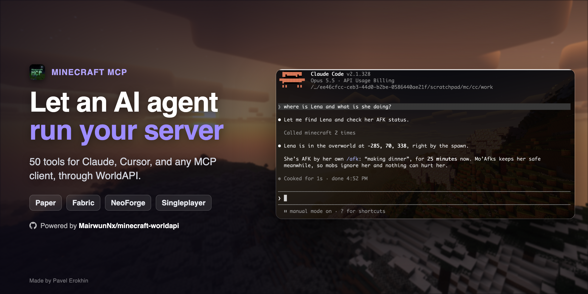
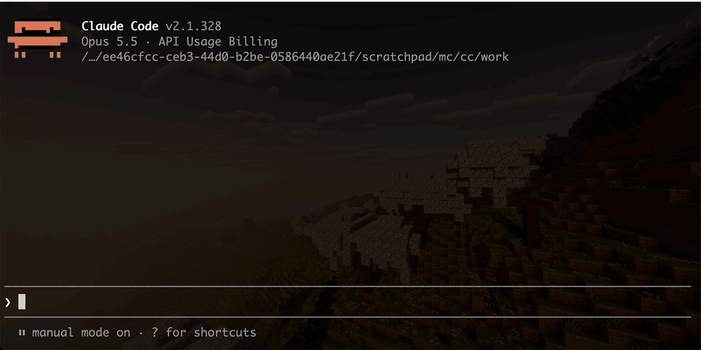
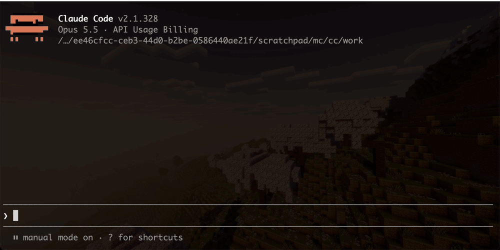
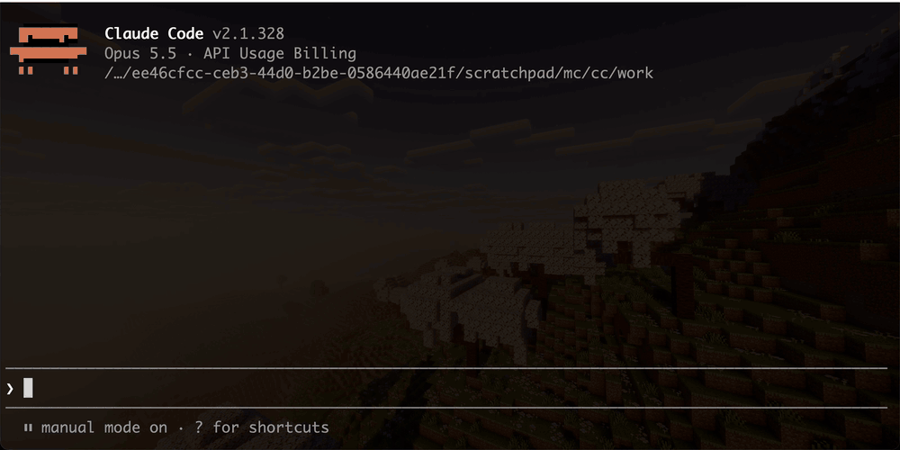
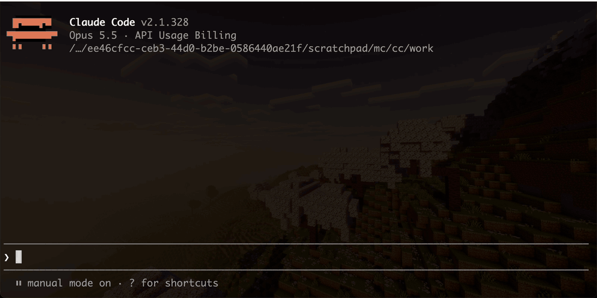
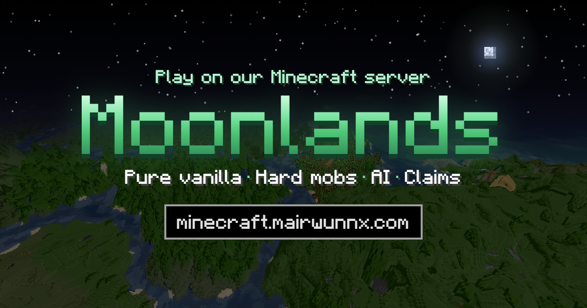

# minecraft-mcp



[](https://www.npmjs.com/package/@mairwunnx/minecraft-mcp) [](https://registry.modelcontextprotocol.io/?q=com.mairwunnx/minecraft-mcp) [](https://glama.ai/mcp/servers/MairwunNx/minecraft-mcp) [](https://github.com/MairwunNx/minecraft-mcp/releases/latest)

🤖 **minecraft-mcp** lets an AI agent see and run your Minecraft server. Ask Claude “who’s online and where are they?”, “why is the server lagging?”, or “give everyone bread and set the time to morning”, and it answers with real data from your world.

It runs next to your AI client: Claude Desktop, Claude Code, Cursor, VS Code, or anything else that speaks MCP. From there it talks to [WorldAPI](https://github.com/MairwunNx/minecraft-worldapi) on a Paper, Fabric, or NeoForge server, or in the world you play alone. The token you give it decides what the agent may do.

[Русская версия](https://github.com/MairwunNx/minecraft-mcp/blob/master/README.RU.md)

## What you get

- 🧰 **50 tools** for the server, worlds, blocks, chests, entities, players, commands, leaderboards, recipes, configs, logs, Java scripts, and other plugins’ data and actions. Most take several targets at once, so the agent makes fewer calls.
- 🎒 **Inventories in depth**: every item’s enchantments, durability, and potion effects, and what’s inside shulker boxes and bundles.
- 📜 **Configs and logs**: the agent reads the console and any config, and with the right token changes a value and keeps its comments.
- 🔑 **Only what your token allows**: a viewer token shows 19 tools that only look, and read-only mode hides every write. Change the token’s permissions, and the tools follow without a restart.
- 🎮 **Singleplayer, no setup**: with the WorldAPI mod in your game, minecraft-mcp finds the open world by itself and follows you from world to world. Ask “what am I looking at?” while you play.
- 🙋 **“Me” means you**: set your player name, and “where am I?” just works.
- ⏳ **Live events**: “tell me when Steve joins”.
- 📣 **Discord and Telegram in one sentence**: “send deaths to my Discord” or “post joins to Telegram in Russian”, and the agent connects them through WorldAPI’s webhooks. Slack, Teams, and Google Chat too.
- ↩️ **Undo**: the agent reads a build before it changes it, and takes back what it placed if you don’t like it.
- 🧭 **Never stuck on setup**: when the address, the token, or WorldAPI itself is missing, the agent says what’s wrong and how to fix it, in game or in the admin panel.
- 🛡️ **Safe by design**: game text is fenced as data, tools say when they destroy something, and the token never leaks.
- 🔌 **Every client**: Claude Desktop in one click, or any MCP client over stdio or HTTP.

## See it work

<p align="center">
  <br><sub>Who’s online and whether the server lags, from the server’s own numbers</sub></p>

<p align="center">
  <br><sub>Where a player is and what they’re doing, the AFK reason included</sub></p>

<p align="center">
  <br><sub>Commands and changes to the world in one sentence</sub></p>

<p align="center">
  <br><sub>Other plugins’ actions too: a Mo’Bosses boss next to a player</sub></p>

## Get started

1. Install [WorldAPI](https://github.com/MairwunNx/minecraft-worldapi) 4.6.0 or newer on your Paper, Fabric, or NeoForge server, and make a token with `/worldapi token create agent`. Playing alone? Put the WorldAPI mod in your game and skip the address and the token: `claude mcp add minecraft -- npx -y @mairwunnx/minecraft-mcp`. The [Singleplayer](https://github.com/MairwunNx/minecraft-mcp/wiki/Singleplayer) page has the rest.
2. Add minecraft-mcp to your client. In Claude Desktop, open [minecraft-mcp.mcpb](https://github.com/MairwunNx/minecraft-mcp/releases/latest/download/minecraft-mcp.mcpb). In Claude Code:

   ```sh
   claude mcp add minecraft -e WORLDAPI_URL=http://localhost:8110/api/v1 -e WORLDAPI_TOKEN=your-token -- npx -y @mairwunnx/minecraft-mcp
   ```

3. Ask “what’s the server status?”. The [Installation](https://github.com/MairwunNx/minecraft-mcp/wiki/Installation) page covers Cursor, VS Code, and HTTP.

## Try it live

Moonlands, my hard survival server with friends, runs WorldAPI and lets anyone read it. Point the agent there without a token:

```sh
claude mcp add moonlands -e WORLDAPI_URL=https://minecraft.mairwunnx.com/worldapi/api/v1 -- npx -y @mairwunnx/minecraft-mcp
```

Then ask “who played the most on Moonlands this week?”.

[](https://minecraft.mairwunnx.com)

## Documentation

Everything else lives in the [wiki](https://github.com/MairwunNx/minecraft-mcp/wiki).

**For players and server owners**

- [Installation](https://github.com/MairwunNx/minecraft-mcp/wiki/Installation), then [Claude Desktop](https://github.com/MairwunNx/minecraft-mcp/wiki/Claude-Desktop), [Claude Code](https://github.com/MairwunNx/minecraft-mcp/wiki/Claude-Code), [Cursor](https://github.com/MairwunNx/minecraft-mcp/wiki/Cursor), or [Other clients](https://github.com/MairwunNx/minecraft-mcp/wiki/Other-clients)
- [Singleplayer](https://github.com/MairwunNx/minecraft-mcp/wiki/Singleplayer)
- [Configuration](https://github.com/MairwunNx/minecraft-mcp/wiki/Configuration)
- [Tokens and permissions](https://github.com/MairwunNx/minecraft-mcp/wiki/Tokens-and-permissions)
- [Tools](https://github.com/MairwunNx/minecraft-mcp/wiki/Tools)
- [Example prompts](https://github.com/MairwunNx/minecraft-mcp/wiki/Example-prompts)
- [Security](https://github.com/MairwunNx/minecraft-mcp/wiki/Security)
- [Troubleshooting](https://github.com/MairwunNx/minecraft-mcp/wiki/Troubleshooting)

**For developers**

- [Building from source](https://github.com/MairwunNx/minecraft-mcp/wiki/Building-from-source)
- [Architecture](https://github.com/MairwunNx/minecraft-mcp/wiki/Architecture)
- [Development](https://github.com/MairwunNx/minecraft-mcp/wiki/Development)
- [Releasing](https://github.com/MairwunNx/minecraft-mcp/wiki/Releasing)

## Related projects

- **[Moonlands](https://minecraft.mairwunnx.com)** – the hard-survival server where all of these run.
- **[WorldAPI](https://github.com/MairwunNx/minecraft-worldapi)** – REST and WebSocket API to the world, players, and stats of a Paper, Fabric, or NeoForge server.
- **[Allay](https://github.com/allay-ai/minecraft)** – an AI helper in the game: ask with `/ask`, right in the chat.
- **[Allay Server](https://github.com/allay-ai/server)** – the backend behind Allay.
- **[Mo’Joins](https://github.com/MairwunNx/mojoins)** – join and quit messages in each player’s language.
- **[Mo’Afks](https://github.com/MairwunNx/moafks)** – a safe AFK mode that doesn’t block the night.
- **[Mo’Bosses](https://github.com/MairwunNx/mobosses)** – monsters that spawn as bosses with classes, abilities, and loot.
- **[minecraft-exporter](https://github.com/MairwunNx/minecraft-exporter)** – Prometheus metrics from WorldAPI.
- **[minecraft-grafana](https://github.com/MairwunNx/minecraft-grafana)** – the Grafana dashboard for WorldAPI.

## Content disclosures

- 🤖 **AI-generated code.** AI agents wrote much of the code.
- 🔌 **For AI clients.** It runs inside your AI client and talks only to the WorldAPI you point it at. It runs no model itself.
- 🎬 **Staged clips.** The clips show the real Claude Code calling minecraft-mcp against a test server, with the model’s replies scripted.
- No telemetry, paid features, or ads.

> 🫡 Made by Pavel Erokhin (Павел Ерохин), aka mairwunnx.
